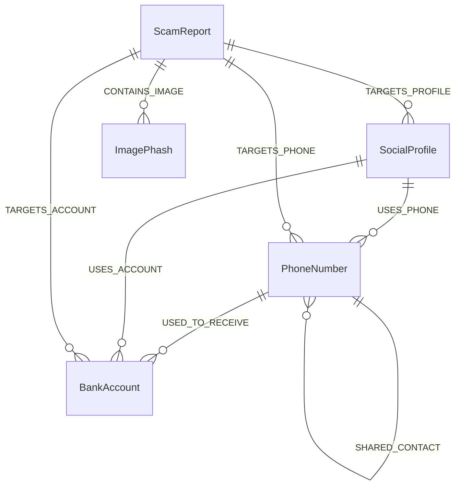

# THIẾT KẾ CƠ SỞ DỮ LIỆU TOÀN DIỆN (DATABASE SCHEMA)

Hệ thống kết hợp mô hình lưu trữ kép (Hybrid Database Architecture):
1. **PostgreSQL 16:** Quản lý dữ liệu người dùng, liên kết gia đình SOS, mã FCM thiết bị, báo cáo lừa đảo, nhật ký sự cố khẩn cấp và khiếu nại.
2. **Neo4j 5.18:** Mô hình hóa mạng lưới quan hệ đa chiều giữa *Số điện thoại, Số tài khoản ngân hàng, Trang cá nhân mạng xã hội (Zalo/Facebook), Mã băm ảnh và Báo cáo vi phạm*, phục vụ thuật toán truy vết 3 bước và tính điểm tín nhiệm.

---

## 1. Cơ sở dữ liệu quan hệ (PostgreSQL 16)

```sql
-- Kích hoạt extension UUID
CREATE EXTENSION IF NOT EXISTS "uuid-ossp";

-- ============================================================================
-- 1. BẢNG NGƯỜI DÙNG (USERS)
-- ============================================================================
CREATE TABLE users (
    id UUID PRIMARY KEY DEFAULT uuid_generate_v4(),
    full_name VARCHAR(100) NOT NULL,
    phone VARCHAR(20) UNIQUE NOT NULL,
    email VARCHAR(100) UNIQUE,
    hashed_password VARCHAR(255) NOT NULL,
    role VARCHAR(20) DEFAULT 'user' CHECK (role IN ('user', 'guardian', 'admin')),
    created_at TIMESTAMP WITH TIME ZONE DEFAULT CURRENT_TIMESTAMP,
    updated_at TIMESTAMP WITH TIME ZONE DEFAULT CURRENT_TIMESTAMP
);

-- ============================================================================
-- 2. BẢNG THIẾT BỊ NGƯỜI DÙNG (USER_DEVICES) - Phục vụ bắn thông báo đẩy FCM
-- ============================================================================
CREATE TABLE user_devices (
    id UUID PRIMARY KEY DEFAULT uuid_generate_v4(),
    user_id UUID NOT NULL REFERENCES users(id) ON DELETE CASCADE,
    fcm_token TEXT NOT NULL UNIQUE,
    device_model VARCHAR(100),
    os_version VARCHAR(50),
    is_active BOOLEAN DEFAULT TRUE,
    created_at TIMESTAMP WITH TIME ZONE DEFAULT CURRENT_TIMESTAMP,
    updated_at TIMESTAMP WITH TIME ZONE DEFAULT CURRENT_TIMESTAMP
);

-- ============================================================================
-- 3. BẢNG LIÊN KẾT BẢO HỘ GIA ĐÌNH (FAMILY_GUARDIANS)
-- ============================================================================
CREATE TABLE family_guardians (
    id UUID PRIMARY KEY DEFAULT uuid_generate_v4(),
    user_id UUID NOT NULL REFERENCES users(id) ON DELETE CASCADE,
    guardian_id UUID NOT NULL REFERENCES users(id) ON DELETE CASCADE,
    relationship VARCHAR(50) NOT NULL, -- "Cha/Mẹ", "Con cái", "Vợ/Chồng", "Người giám hộ"
    is_confirmed BOOLEAN DEFAULT TRUE,
    created_at TIMESTAMP WITH TIME ZONE DEFAULT CURRENT_TIMESTAMP,
    CONSTRAINT unique_user_guardian UNIQUE(user_id, guardian_id)
);

-- ============================================================================
-- 4. BẢNG SỰ CỐ KHẨN CẤP SOS (SOS_ALERTS) - Nhật ký kích hoạt báo động
-- ============================================================================
CREATE TABLE sos_alerts (
    id UUID PRIMARY KEY DEFAULT uuid_generate_v4(),
    user_id UUID NOT NULL REFERENCES users(id) ON DELETE CASCADE,
    guardian_id UUID REFERENCES users(id) ON DELETE SET NULL,
    trigger_reason VARCHAR(100) NOT NULL, -- "CALL_SCREENING_CRITICAL", "VIETQR_CRITICAL_TRANSFER"
    suspicious_value VARCHAR(100) NOT NULL, -- Số điện thoại hoặc Số tài khoản nghi vấn
    risk_score DOUBLE PRECISION NOT NULL,
    lat DOUBLE PRECISION,
    lng DOUBLE PRECISION,
    status VARCHAR(30) DEFAULT 'ACTIVE' CHECK (status IN ('ACTIVE', 'ACKNOWLEDGED', 'RESOLVED', 'FALSE_ALARM')),
    acknowledged_at TIMESTAMP WITH TIME ZONE,
    created_at TIMESTAMP WITH TIME ZONE DEFAULT CURRENT_TIMESTAMP
);

-- ============================================================================
-- 5. BẢNG BÁO CÁO TỐ CÁO LỪA ĐẢO (SCAM_REPORTS)
-- ============================================================================
CREATE TABLE scam_reports (
    id UUID PRIMARY KEY DEFAULT uuid_generate_v4(),
    reporter_id UUID REFERENCES users(id) ON DELETE SET NULL,
    entity_type VARCHAR(30) NOT NULL CHECK (entity_type IN ('bank_account', 'phone_number', 'social_profile')),
    entity_value VARCHAR(100) NOT NULL,
    bank_code VARCHAR(20), -- Mã BIN ngân hàng (970415, 970436,...) nếu là bank_account
    incident_type VARCHAR(50) NOT NULL CHECK (incident_type IN ('DEPOSIT_SCAM', 'RECRUIT_SCAM', 'IMPERSONATION_SCAM')),
    title VARCHAR(200) NOT NULL,
    description TEXT NOT NULL,
    evidence_image_url TEXT NOT NULL, -- Ảnh chụp ủy nhiệm chi/biên lai chuyển khoản
    status VARCHAR(30) DEFAULT 'PENDING' CHECK (status IN ('PENDING', 'APPROVED', 'REJECTED', 'DISPUTED')),
    reviewer_id UUID REFERENCES users(id),
    reviewed_at TIMESTAMP WITH TIME ZONE,
    lat DOUBLE PRECISION,
    lng DOUBLE PRECISION,
    created_at TIMESTAMP WITH TIME ZONE DEFAULT CURRENT_TIMESTAMP
);

-- ============================================================================
-- 6. BẢNG MÃ BĂM TRI GIÁC ẢNH GIAN LẬN (IMAGE_HASHES)
-- ============================================================================
CREATE TABLE image_hashes (
    id UUID PRIMARY KEY DEFAULT uuid_generate_v4(),
    report_id UUID NOT NULL REFERENCES scam_reports(id) ON DELETE CASCADE,
    phash VARCHAR(64) NOT NULL,
    image_url TEXT NOT NULL,
    created_at TIMESTAMP WITH TIME ZONE DEFAULT CURRENT_TIMESTAMP
);

-- ============================================================================
-- 7. BẢNG KHIẾU NẠI & MINH OAN CHÍNH CHỦ (DISPUTES)
-- ============================================================================
CREATE TABLE disputes (
    id UUID PRIMARY KEY DEFAULT uuid_generate_v4(),
    report_id UUID NOT NULL REFERENCES scam_reports(id) ON DELETE CASCADE,
    applicant_name VARCHAR(100) NOT NULL,
    applicant_phone VARCHAR(20) NOT NULL,
    reason TEXT NOT NULL,
    citizen_id_front_url TEXT NOT NULL,
    citizen_id_back_url TEXT NOT NULL,
    status VARCHAR(30) DEFAULT 'PROCESSING' CHECK (status IN ('PROCESSING', 'ACCEPTED', 'REJECTED')),
    resolved_at TIMESTAMP WITH TIME ZONE,
    created_at TIMESTAMP WITH TIME ZONE DEFAULT CURRENT_TIMESTAMP
);

-- ============================================================================
-- 8. BẢNG LỊCH SỬ TRA CỨU & KIỂM CHỨNG (LOOKUP_HISTORY)
-- ============================================================================
CREATE TABLE lookup_history (
    id UUID PRIMARY KEY DEFAULT uuid_generate_v4(),
    user_id UUID REFERENCES users(id) ON DELETE SET NULL,
    entity_type VARCHAR(30) NOT NULL,
    entity_value VARCHAR(100) NOT NULL,
    risk_score DOUBLE PRECISION NOT NULL,
    risk_level VARCHAR(20) NOT NULL,
    lat DOUBLE PRECISION,
    lng DOUBLE PRECISION,
    created_at TIMESTAMP WITH TIME ZONE DEFAULT CURRENT_TIMESTAMP
);

-- Chỉ mục tối ưu hóa hiệu năng
CREATE INDEX idx_reports_entity ON scam_reports(entity_type, entity_value);
CREATE INDEX idx_reports_location ON scam_reports(lat, lng);
CREATE INDEX idx_image_hashes_phash ON image_hashes(phash);
CREATE INDEX idx_user_devices_token ON user_devices(fcm_token);
CREATE INDEX idx_sos_alerts_user ON sos_alerts(user_id, status);
CREATE INDEX idx_lookup_history_entity ON lookup_history(entity_value);
```

---

## 2. Cơ sở dữ liệu đồ thị (Neo4j 5.18)

### 2.1. Nhãn nút (Node Labels) & Thuộc tính
1. **`:PhoneNumber`**
   * `phone`: String (Số điện thoại, Khóa định danh duy nhất)
   * `carrier`: String (Nhà mạng: Viettel, Vinaphone, Mobifone,...)
   * `risk_score`: Float (Điểm rủi ro tích lũy)
2. **`:BankAccount`**
   * `account_number`: String (Số tài khoản)
   * `bank_bin`: String (Mã định danh ngân hàng VietQR, ví dụ: 970415)
   * `bank_name`: String (VietinBank, Vietcombank,...)
   * `account_name`: String (Tên chủ thẻ/tài khoản)
3. **`:SocialProfile`**
   * `profile_id`: String (Định danh trang cá nhân, Khóa duy nhất)
   * `platform`: String ("Facebook", "Zalo", "Telegram")
   * `profile_name`: String (Tên hiển thị)
   * `profile_url`: String (Đường dẫn trang cá nhân)
4. **`:ScamReport`**
   * `report_id`: String (Khóa duy nhất tham chiếu sang PostgreSQL)
   * `incident_type`: String ("DEPOSIT_SCAM", "RECRUIT_SCAM", "IMPERSONATION_SCAM")
   * `is_verified`: Boolean (Đã được kiểm duyệt xác nhận vi phạm)
   * `created_at`: String (Thời điểm báo cáo)
5. **`:ImagePhash`**
   * `hash_value`: String (Chuỗi hex mã băm tri giác 64-bit)

---

### 2.2. Các mối quan hệ (Relationships)



---

### 2.3. Lệnh tạo ràng buộc & Chỉ mục (Cypher DDL)

```cypher
// Ràng buộc tính duy nhất
CREATE CONSTRAINT unique_phone IF NOT EXISTS
FOR (p:PhoneNumber) REQUIRE p.phone IS UNIQUE;

CREATE CONSTRAINT unique_bank_account IF NOT EXISTS
FOR (b:BankAccount) REQUIRE (b.account_number, b.bank_bin) IS UNIQUE;

CREATE CONSTRAINT unique_social_profile IF NOT EXISTS
FOR (s:SocialProfile) REQUIRE s.profile_id IS UNIQUE;

CREATE CONSTRAINT unique_report IF NOT EXISTS
FOR (r:ScamReport) REQUIRE r.report_id IS UNIQUE;

CREATE CONSTRAINT unique_phash IF NOT EXISTS
FOR (i:ImagePhash) REQUIRE i.hash_value IS UNIQUE;
```

---

### 2.4. Mẫu truy vấn Cypher nghiệp vụ thực tế

#### Truy vết đường đi ngắn nhất đến mắt xích lừa đảo trong phạm vi 3 bước
```cypher
MATCH (start:BankAccount {account_number: $account_number, bank_bin: $bank_bin})
MATCH path = shortestPath((start)-[*..3]-(scam:ScamReport {is_verified: true}))
RETURN path, length(path) AS hops, scam.report_id AS report_id
ORDER BY hops ASC
LIMIT 1;
```

#### Xuất toàn bộ mạng lưới phục vụ hiển thị Cytoscape.js trên Web
```cypher
MATCH (target:BankAccount {account_number: $account_number, bank_bin: $bank_bin})
CALL apoc.path.subgraphAll(target, {maxLevel: 2})
YIELD nodes, relationships
RETURN nodes, relationships;
```
