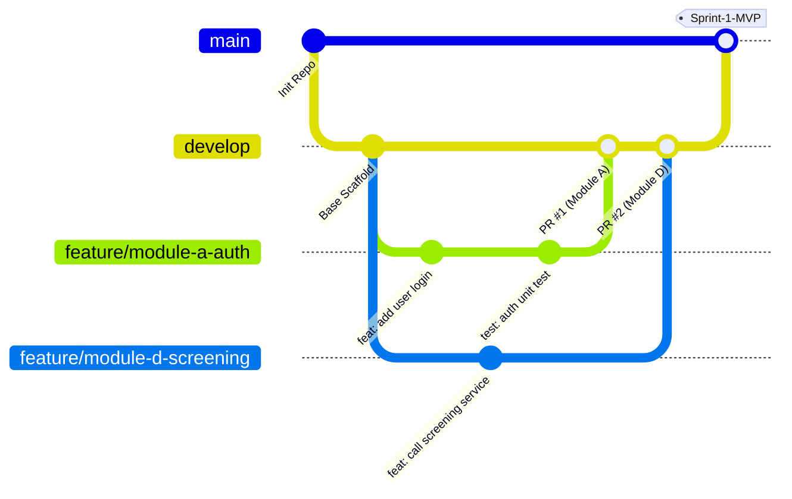

# QUY CHUẨN GIT & NHỊP LÀM VIỆC HÀNG TUẦN (GIT WORKFLOW)

Tài liệu này quy định kỷ luật làm việc bằng Git và quy trình phối hợp nội bộ cho 4 thành viên Nhóm 03.

---

## 1. Mô hình phân nhánh (Branching Strategy)

Nhóm áp dụng mô hình **Gitflow rút gọn (Simplified Gitflow)**:



### Các nhánh cố định:
* **`main`:** Nhánh phát hành chính thức (Release). Chỉ merge từ `develop` vào cuối mỗi Sprint khi đã hoàn thành kiểm thử để demo cho Giảng viên hướng dẫn.
* **`develop`:** Nhánh làm việc trung tâm. Tất cả các tính năng mới của 4 thành viên đều xuất phát từ `develop` và được merge ngược lại vào `develop` thông qua Pull Request (PR).

### Quy tắc đặt tên nhánh tính năng:
Cú pháp: `feature/<module>-<tên-ngắn-gọn>`
* Module A (Backend): `feature/module-a-auth-api`, `feature/module-a-report-approval`
* Module B (Graph): `feature/module-b-neo4j-schema`, `feature/module-b-credit-scoring`
* Module C (Web): `feature/module-c-cytoscape-graph`, `feature/module-c-alert-map`
* Module D (Android): `feature/module-d-call-screening`, `feature/module-d-sos-trigger`
* Sửa lỗi: `fix/<tên-lỗi>` (ví dụ: `fix/jwt-expiration-bug`)

---

## 2. Quy chuẩn Commit Message (Conventional Commits)

Mỗi commit phải giải thích ngắn gọn, rõ ràng thay đổi đã thực hiện. Tuyệt đối không commit chung chung như *"update"*, *"fix bug"*, *"done"*.

### Cấu trúc commit:
```text
<loại>(<phạm vi>): <mô tả ngắn bằng tiếng Việt hoặc tiếng Anh>
```

### Danh mục `<loại>` được phép sử dụng:
* **`feat`:** Bổ sung tính năng mới. (Ví dụ: `feat(api): them endpoint giai ma ma vietqr`)
* **`fix`:** Sửa lỗi. (Ví dụ: `fix(android): sua loi crash khi nhan thong bao zalo`)
* **`docs`:** Thay đổi tài liệu, proposal, README. (Ví dụ: `docs(api): bo sung dac ta endpoint sos`)
* **`refactor`:** Tối ưu, cơ cấu lại code nhưng không đổi hành vi. (Ví dụ: `refactor(graph): toi uu cau lenh cypher 3 hops`)
* **`test`:** Bổ sung unit test. (Ví dụ: `test(scoring): them test case tinh diem tin nhiem`)
* **`chore`:** Cập nhật file cấu hình, `.gitignore`, Dockerfile. (Ví dụ: `chore: them plugin apoc vao docker neo4j`)

---

## 3. Quy trình tạo và duyệt Pull Request (PR)

1. **Trước khi tạo PR:**
   * Kéo code mới nhất từ `develop` về nhánh của mình:
     ```bash
     git checkout feature/<ten-nhanh>
     git pull origin develop
     ```
   * Chạy thử hệ thống trên máy cá nhân để chắc chắn không gãy tính năng cũ.
2. **Tạo Pull Request trên GitHub:**
   * Base branch: `develop` $\leftarrow$ Compare branch: `feature/<ten-nhanh>`
   * Điền đầy đủ form mẫu theo template `.github/PULL_REQUEST_TEMPLATE.md`.
3. **Duyệt và Hợp nhất (Review & Merge):**
   * **Bắt buộc có ít nhất 1 thành viên khác review và bấm "Approve"**.
   * Chọn kiểu merge: **Squash and merge** để gộp các commit vụn vặt thành 1 commit duy nhất trên nhánh `develop`.
   * Xóa nhánh feature sau khi merge thành công.

---

## 4. Nhịp sinh hoạt tuần của nhóm (Weekly Rhythm)

| Thời điểm | Hoạt động | Mục tiêu |
| :--- | :--- | :--- |
| **Thứ Hai (20:00 - 20:30)** | **Sprint Planning / Đầu tuần** | Phân chia 2–3 task cụ thể cho từng thành viên trên GitHub Projects. |
| **Thứ Năm (21:00 - 21:15)** | **Mid-week Sync (Online)** | Báo cáo nhanh các điểm nghẽn kỹ thuật (blocker) để hỗ trợ chéo. |
| **Chủ Nhật (17:00 - 18:30)** | **Review, Merge & Báo cáo** | Hợp nhất toàn bộ PR vào `develop`, chụp ảnh minh chứng tiến độ, xuất slide/báo cáo gửi GVHD. |
